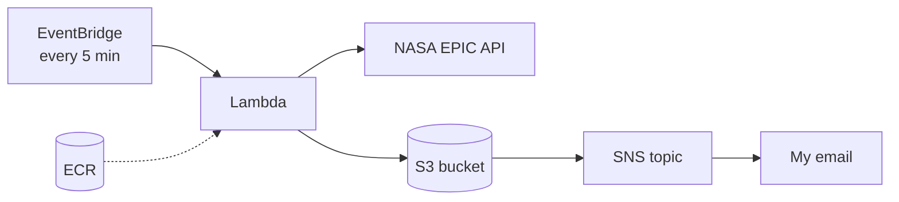

# NASA EPIC Image Pipeline

This was a project for my cloud computing class at USU (spring 2026). It pulls Earth photos from NASA's EPIC API every 5 minutes and puts them in an S3 bucket. Every time an image gets uploaded, I get an email about it.

## How it's set up

- EventBridge Scheduler runs the Lambda function every 5 minutes.
- The Lambda runs from a Docker image I pushed to ECR. It grabs the previous day's images from NASA and uploads them to S3.
- Each upload sends an event to an SNS topic, and SNS emails me.
- I set Lambda to 512 MB of memory with a 5 minute timeout.

My first test run pulled 13 images and uploaded them in about 11 seconds.

## Files

- `Dockerfile.lambda` builds the Lambda image
- `commands.sh` has the AWS CLI commands I ran, in order
- `test-event.json` is what I used to test it by hand
- `schedule-input.json` is what EventBridge sends on each run

## What broke

Lambda kept rejecting my image. Docker on my Mac was adding an extra manifest that Lambda can't read, so I had to build with `docker buildx build --provenance=false`.

The NASA package uses hatchling to build, so the Dockerfile has to install hatchling, hatch-vcs and git before it can install the package.

Creating the schedule failed the first couple of times because the IAM role I had just made wasn't ready yet. Waiting a few seconds and running it again fixed it.

## If I did it again

I gave Lambda full S3 access, which is way more than it needs. I'd lock it down to just this bucket. I'd also run it once a day instead of every 5 minutes, since it only pulls the previous day's images anyway.

## Credit

The NASA client package and the Lambda handler came from my class's starter repo, [czabriskie/earth-polychromatic-imaging-camera-api](https://github.com/czabriskie/earth-polychromatic-imaging-camera-api) (v1.2.0). I did the Docker image, IAM roles, Lambda setup, S3 and SNS, and the schedule.

I tore everything down and closed the AWS account after the class.

## Screenshots

<!-- drag screenshots here -->

---

*AI note: I used Claude (an AI assistant) while building this to help with the code and debugging, and to help write this README.*
